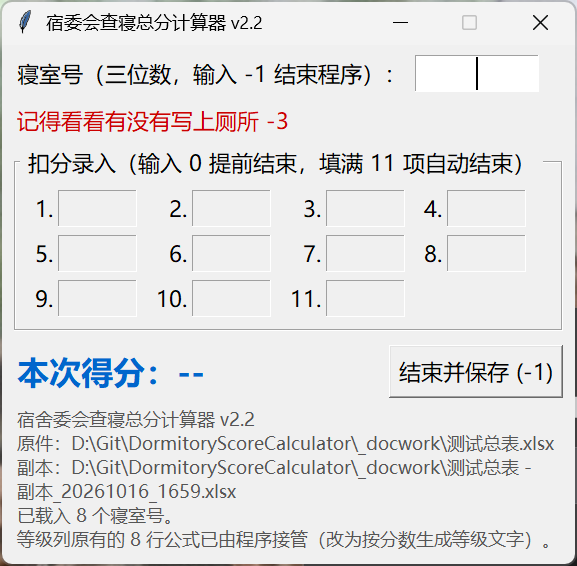

# 宿委会查寝总分计算器 · 使用说明

版本：2026-10-15　　适用：64 位 Windows 10 / 11　　程序文件：查寝总分计算器.exe

## 一、这个程序是干什么的

查寝时你在纸质表上记的是“扣分绝对值”，故本程序输入的也为“扣分绝对值”。

这个程序把每个寝室最多 11 个扣分段的扣分加起来，用 100 减去它们，算出这个寝室的总分，自动写进 Excel 总表的“分数”列，并同时写上“等级”（≥90 优秀／80~89 良好／60~79 合格／60 以下不合格）。

它最大的好处是：Excel 的“总表原件”永远不被改动。程序会在原件旁边自动生成一份副本，所有分数只写进副本，原件保持原样，随时可以重来。

v2.2 起“等级”由程序直接算出来写进表里，不再依赖 Excel 公式重算——副本里原来的等级公式会被替换成等级文字。

## 二、运行环境与安装

- **免安装：**不用安装任何东西。程序已经把需要的运行环境打包在自己身上，双击就能开。
- **系统要求：**64 位 Windows 10 或 Windows 11。
- **首次运行提示：**第一次运行时 Windows 可能弹蓝色的“Windows 已保护你的电脑”，点“更多信息” → “仍要运行”即可。这是没有购买数字签名的正常提示，不是病毒。
- **存放建议：**把 exe 放在桌面、文档或 D 盘等你自己有权限的文件夹里。放到 C:\Program Files 也可以运行，但副本要写在 Excel 所在文件夹，所以 Excel 表本身必须放在可写的位置。

## 三、界面说明

- **① 寝室号输入框：**输入三位寝室号（例如 405）；输入 -1 表示全部查完，结束程序。
- **② 红字提醒“记得看看有没有写上厕所 -3”：**由于作者曾查的寝室为公共卫浴，厕所与阳台项统一扣 3 分，常遇见忘填此项导致出错，故增加此提示语句。
- **③ 扣分录入 1~11：**最多 11 个，对应纸质表的 11 个扣分段；每填一格按一次回车。
- **④ 本次得分 / 等级：**显示本次算出来的分数和对应的等级。
- **⑤ 结束并保存 (-1)：**点它等于输入 -1，会保存副本并退出。
- **⑥ 底部信息：**显示总表原件路径、副本路径、载入了多少个寝室号。核对一下这两条路径，能第一时间发现选错文件。

## 四、操作流程

1. 双击“查寝总分计算器.exe”。
1. 先看完免责声明（红字弹窗），点“我已知晓”或直接按回车才能继续。
1. 弹出的文件框里选择总表原件，点“打开”。
1. 程序在同文件夹生成副本，名字形如“原件 - 副本_20261015_1533.xlsx”。看一眼窗口底部，确认副本路径正确。
1. 在寝室号框里输入三位寝室号（例如 405），按回车。程序会在 F 列（tag）里找它对应的行。
1. 光标自动跳到第 1 个扣分格。每填一个扣分按一次回车，光标自动跳到下一格；纸质表上没有的格子不用管。
1. 最后一个扣分填完按回车，或者在某一个空格里填 0 再按回车——两种方式都表示“这个寝室录完了”。
1. 屏幕上出现“本次得分：xx”，同时分数写进副本对应行，状态栏提示“已写入……”。
1. 核对一下分数，然后按一次回车：程序会锁住扣分格（防手快连按），光标已经在寝室号框里，按回车就开始量下一个寝室；也可以直接输入下一个寝室号。
1. 全部量完，在寝室号框里输入 -1 按回车，程序保存并退出，并告诉你副本路径。（等待确认状态下直接输入 -1 也能退出。）

小提示：11 个扣分格全部填满时，程序会自动结算，同样等你按一次回车再继续；等待确认期间扣分格是锁住的，只响应寝室号框里的回车。

备注：

每次启动程序都会先弹出下面这段红字提示，点“我已知晓”或按回车才能进入。原文：

> 【免责声明】
> 本程序是作者第一次动手写的小工具，可能还存在没有发现的 Bug，计算结果仅供参考。
> 请务必自行核实程序生成的表格内容（分数、等级、寝室号是否对得上），确认无误后再使用或上缴。
> 如果发现程序出错、数字不对，或者有改进建议，欢迎加 QQ 反馈：3521228485。

**程序算完不等于万事大吉，请一定要抽查、核对生成的表格；发现问题请加 QQ 3521228485 反馈。**

## 五、几种特殊情况

| 情况 | 程序的表现 |
| --- | --- |
| 该寝室 D 列已经有分数 | 弹窗问“该寝室已有分数，是否覆盖？ 是（Y）或否（N）”，并显示当前分数与等级 |
| 覆盖弹窗选“是” | 用新分数覆盖旧分数，等级跟着一起更新，副本立即保存 |
| 覆盖弹窗选“否” | 本次结果丢弃，原来的分数和等级都不动，同样等你按回车再继续 |
| 寝室号不是三位数 | 提示“寝室号必须是三位整数”，可以重新输入 |
| F 列找不到这个寝室号 | 提示“没有找到”，多半是选错了楼栋或学期的总表 |
| 前一个格子空着就跳到后面填 | 提示“请从第 N 格开始按顺序填”，并把光标送回该填的格子 |
| 扣分格里敲字母 | 打不进去，只允许数字 |

## 六、对 Excel 总表的要求

- **表头必须和现有原件一致：**A 列：寝室号（如“桃花坪学生宿舍19栋201”），B 列学院，C 列年级；
- **D 列是“分数”列，**D1 写“分数”，分数从 D2 开始往下填；
- **E 列是“等级”列，**等级由程序直接写成文字，不需要你自己算，也不需要 Excel 公式；副本里原有的等级公式会被程序替换掉。
- **最关键的一列：**F 列是 tag 列，存三位寝室号（如 201），程序靠它找行。
- **如果 F 列是公式（如 =SUBSTITUTE(A2,"桃花坪学生宿舍19栋","")），**程序读的是 Excel 上次保存时算出的值。所以这份表至少要先用 Excel 打开并保存过一次；从没打开过的新表，F 列可能没有值，会提示找不到寝室号。
- **程序写入时不会改单元格格式。**

## 七、常见问题（FAQ）

| 现象 / 报错 | 原因与处理 |
| --- | --- |
| 双击后窗口一闪就没了 / 报错 Could not create temporary directory! | 当前版本已修复（会优先在自己所在文件夹里解压）。若极少数电脑仍报此错，请联系作者。 |
| 读取失败：没有在所选表格的 F 列（tag）中找到任何寝室号 | 选错了文件。请选含 tag 列的总表原件。 |
| 复制失败 / 写入副本失败 / Permission denied | 原件所在文件夹只读，或副本正被 Excel 打开。关掉 Excel 里的同名文件，或把表移到可写文件夹再试。 |
| 找不到寝室号 | 纸质表上的房间不在这次的总表里，核对原件是否包含该房间。 |
| 等级那一列空着 | 等级是和分数一起写进去的；那一行还没有录分数，所以等级也是空的。 |
| 想知道程序改了什么 | 原件绝对没被改过；所有结果都在“原件 - 副本_时间戳.xlsx”里。 |
