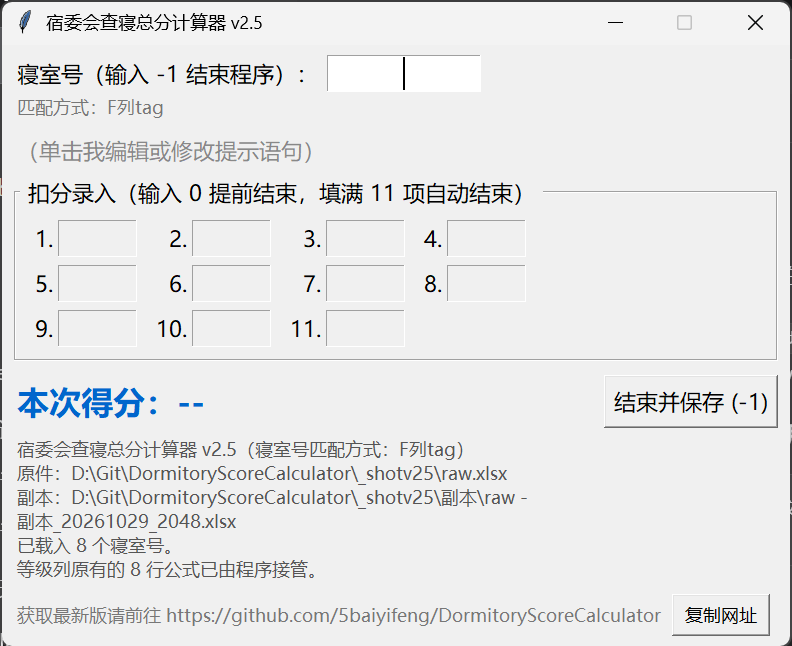

# 宿委会查寝总分计算器 · 使用说明

版本：2026-10-29　　适用：64 位 Windows 10 / 11　　程序文件：查寝总分计算器v2.5.exe

## 一、这个程序是干什么的

查寝时你在纸质表上记的是“扣分绝对值”，故本程序输入的也为“扣分绝对值”。

纸质版上不扣分的词段不需要填“0”，所以本程序也不用输 0。0 只在所有非零扣分都输完之后填一次，表示“这个寝室录完了”，程序会自动结算。

如某寝室 11 个词段的扣分分别为 1、2、3、4、0、5、6、7、0、8、9，程序中应依次输入 1、2、3、4、5、6、7、8、9，最后再输一个 0——最后的 0 表示录完。

这个程序把每个寝室最多 11 个扣分段的扣分加起来，用 100 减去它们，算出这个寝室的总分，自动写进 Excel 总表的“分数”列，并同时写上“等级”（≥90 优秀／80~89 良好／60~79 合格／60 以下不合格）。

它最大的好处是：Excel 的“总表原件”永远不被改动。程序会在原件旁边的「副本」子文件夹里生成一份带时间戳的副本，所有分数只写进副本，原件保持原样，随时可以重来。

v2.5 相较以前：① 启动时可以选“怎么在总表里找寝室号”；② 录错了可以按 Ctrl + 退格撤回重填；③ 副本统一收进「副本」子文件夹；④ 界面上那句提醒可以单击改成自己的话，改完下次打开还在；⑤ 第 1 格填 w / s，能直接把“无人”/“锁”记进分数列。

## 二、运行环境与安装

- **免安装：**不用安装任何东西。程序已经把需要的运行环境打包在自己身上，双击就能开。
- **系统要求：**64 位 Windows 10 或 Windows 11。
- **首次运行提示：**第一次运行时 Windows 可能弹蓝色的“Windows 已保护你的电脑”，点“更多信息” → “仍要运行”即可。这是没有购买数字签名的正常提示，不是病毒。
- **存放建议：**把 exe 放在桌面、文档或 D 盘等你自己有权限的文件夹里。放到 C:\Program Files 也可以运行，但副本要写在 Excel 所在文件夹，所以 Excel 表本身必须放在可写的位置。

## 三、界面说明

- **① 寝室号输入框：**输入寝室号（例如 201）；输入 -1 表示全部查完，结束程序。
- **② 匹配方式：**显示这次是用“F 列 tag”还是“由程序读取寝室号”来找行，方便你随时确认。
- **③ 提示语句（可以自己改）：**默认显示灰色的一行“（单击我编辑或修改提示语句）”。用鼠标左键单击它，会弹出一个小编辑窗（见下图），把想提醒自己的话填进去点“确定”，它就变成红色常驻显示；下次打开程序还是这句。想恢复默认，把内容清空再点“确定”即可。

提示语句的写法：最长 30 个汉字（英文字母、数字、一般符号按半个汉字算，合计不超过 60），超出上限的字打不进去；编辑窗里会实时显示“已用 x / 60”。

- **④ 扣分录入 1~11：**最多 11 个，对应纸质表的 11 个扣分段；每填一格按一次回车。**也可以用鼠标点下一格**——点走的时候程序会自动把上一格记下来，不习惯按回车就这么点着录。第 1 格除了数字，还能填 w / s（无人 / 锁），用法见第四节。
- **⑤ 本次得分 / 等级：**显示本次算出来的分数和对应的等级。
- **⑥ 结束并保存 (-1)：**点它等于输入 -1，会保存副本并退出。
- **⑦ 底部信息：**显示总表原件路径、副本路径、载入了多少个寝室号。核对一下这两条路径，能第一时间发现选错文件。
- **⑧ 获取最新版 / 复制网址：**最底下一行是项目地址（GitHub 仓库），点旁边的「复制网址」按钮会把它写进剪贴板，直接粘到浏览器就能打开；复制成功后按钮会短暂变成「已复制」。

另外，程序启动后还会先弹出一个选择窗口（如下图），用来决定怎么在总表里找寝室号：

- **使用 F 列 tag（推荐）：**靠表里已有的 tag 列匹配，前提是总表中要手动设置了F列！！！！！！
- **由程序读取寝室号（测试中）：**从 A 列“寝室号”里解析楼栋号+房号，不依赖 tag。

## 四、操作流程

1. 双击“查寝总分计算器v2.5.exe”。
1. 先看完免责声明（红字弹窗），点“我已知晓”或直接按回车才能继续。
1. 选择怎么在总表里找寝室号：启动后会先弹「选择寝室号匹配方式」，点「使用F列tag（推荐）」或「由程序读取寝室号（测试中）」；直接按回车就是推荐的 F 列 tag（前提是要手动设置了tag列！！！！！）。（两种方式的区别见第三节）
1. 弹出的文件框里选择总表原件，点“打开”。
1. 程序会在原件所在文件夹的「副本」子文件夹里生成副本，名字形如“原件 - 副本_20261016_1533.xlsx”。看一眼窗口底部，确认副本路径正确。
1. 在寝室号框里输入寝室号，按回车。程序会按你刚才选的方式去找行：选「F 列 tag」就输三位房号（如 201）；选「由程序读取寝室号」就输“19栋201”（写 19-201，或只写 201 也行）。
1. 光标自动跳到第 1 个扣分格。每填一个扣分按一次回车，光标自动跳到下一格；纸质表上没有的格子不用管。
1. 所有非零扣分输完后，在下一个空格里填一个 `0` 按回车；如果正好填满了 11 格，程序也会自动结算——两种方式都表示“这个寝室录完了”。
1. 屏幕上出现“本次得分：xx”，同时分数写进副本对应行，状态栏提示“已写入……”。
1. 核对一下分数，然后按一次回车：程序会锁住扣分格（防手快连按），光标已经在寝室号框里，按回车就开始量下一个寝室；也可以直接输入下一个寝室号。
1. 全部量完，在寝室号框里输入 -1 按回车，程序保存并退出，并告诉你副本路径。（等待确认状态下直接输入 -1 也能退出。）

小提示：11 个扣分格全部填满时，程序会自动结算，同样等你按一次回车再继续；等待确认期间扣分格是锁住的，只响应寝室号框里的回车。

记「无人」和「锁」：这个寝室没人住，第 1 格直接填 w 按回车；门锁着进不去，填 s 按回车。程序会把“无人”或“锁”写进分数列、等级列留空，不用再填后面 10 格。

按错了怎么办：已经按回车记录过的扣分，可以按 **Ctrl + 退格**（先按住 Ctrl 键，再按一下退格）把最近那一格撤回来重填，不用把这个寝室从头录一遍。**普通退格只删当前格里的字**，不会撤销上一格，所以想改哪一格的字直接改就行。已结算、正在等你按回车确认时，Ctrl + 退格也不会撤销（那时分数已经写进副本了）。

选错找寝室号的方式也不要紧：如果选了“使用 F 列 tag”但那张表其实没有 tag 列，程序会提示「tag 列为空」，点“确定”后自动回到选择窗口，改选“由程序读取寝室号”就能继续——刚才选的表不用重新挑。

备注：

每次启动程序都会先弹出下面这段红字提示，点“我已知晓”或按回车才能进入。原文：

> 【免责声明】
> 本程序是作者第一次动手写的小工具，可能还存在没有发现的 Bug，计算结果仅供参考。
> 请务必自行核实程序生成的表格内容（分数、等级、寝室号是否对得上），确认无误后再使用或上缴。
> 如果发现程序出错、数字不对，或者有改进建议，欢迎加 QQ 反馈：3521228485。

**程序算完不等于万事大吉，请一定要抽查、核对生成的表格；发现问题请加 QQ 3521228485 反馈。**

## 五、几种特殊情况

| 情况 | 程序的表现 |
| --- | --- |
| 该寝室 D 列已经有分数 | 弹窗问“该寝室已有分数，是否覆盖？ 是（Y）或否（N）”，并显示当前分数与等级 |
| 覆盖弹窗选“是” | 用新分数覆盖旧分数，等级跟着一起更新，副本立即保存 |
| 覆盖弹窗选“否” | 本次结果丢弃，原来的分数和等级都不动，同样等你按回车再继续 |
| 选了“使用 F 列 tag”却找不到某个房间 | 提示“没有找到”，多半是输入和 tag 值对不上，或这张表里没有这个房间 |
| 选了“由程序读取寝室号”却找不到 | 提示“按当前方式（A列寝室号）没有找到 xxx”，请核对写法 |
| 只写房号（如 201）时 | 如果表里有两个不同楼栋的同号房间，会匹配到先出现的那一行，建议写成“19栋201” |
| 前一个格子空着就跳到后面填 | 提示“请从第 N 格开始按顺序填”，并把光标送回该填的格子 |
| 第 2~11 格敲字母 | 打不进去，只收数字；字母只有在第 1 格填 w（无人）/ s（锁）时才有用，其他字母一律拦下 |
| 当前格里按退格（不带 Ctrl） | 只删掉这一格里的字，不会撤销上一格 |
| Ctrl + 退格 | 把最近按回车记录的那一格撤回，光标跳回该格并自动全选 |
| 已结算、等待按回车确认时按 Ctrl + 退格 | 不撤销（分数已写进副本，避免与已保存的数据不一致） |
| 第 1 格填 w 按回车 | 分数列写“无人”，等级列留空，不用再填后面 10 格 |
| 第 1 格填 s 按回车 | 分数列写“锁”，等级列留空，同上 |
| 该行原来已有分数，又填了 w / s | 同样弹“是否覆盖”，选“否”就保留原来的内容 |
| 用鼠标点下一格 | 等价于按回车：离开这一格时，里面填的数字会自动记下来，光标落在你点的那一格 |

## 六、对 Excel 总表的要求

- **表头必须和现有原件一致：**A 列：寝室号（如“桃花坪学生宿舍19栋201”），B 列学院，C 列年级；
- **D 列是“分数”列，**D1 写“分数”，分数从 D2 开始往下填。这一列也可能是文字“无人”/“锁”（第 1 格填 w / s 时写入）；下次再录这个寝室时，程序会把它当作“已有分数”问你要不要覆盖。
- **E 列是“等级”列，**等级由程序直接写成文字，不需要你自己算，也不需要 Excel 公式；副本里原有的等级公式会被程序替换掉。
- **用“使用 F 列 tag”方式时：**F 列是 tag 列，存三位寝室号（如 201），程序靠它找行。如果 F 列是公式（如 =SUBSTITUTE(A2,"桃花坪学生宿舍19栋","")），程序读的是 Excel 上次保存时算出的值，所以这份表至少要先用 Excel 打开并保存过一次。
- **用“由程序读取寝室号”方式时：**A 列必须真的是寝室号，并且里面能看到楼栋号和房号的数字（如“桃花坪学生宿舍19栋201”），程序就靠它解析。
- **程序写入时不会改单元格格式。**

## 七、常见问题（FAQ）

| 现象 / 报错 | 原因与处理 |
| --- | --- |
| 双击后窗口一闪就没了 / 报错 Could not create temporary directory! | 当前版本已修复（会优先在自己所在文件夹里解压）。若极少数电脑仍报此错，请联系作者。 |
| 提示「tag 列为空」 | 这张表的 F 列里没有 tag 值（或根本没有 tag 列）。点确定后会自动回到选择窗口，改选“由程序读取寝室号”就能继续 |
| 提示「A 列没有寝室号」 | 这张表的第一列不是寝室号，或格式里看不到数字。点确定后回到选择窗口，改选“使用 F 列 tag”。 |
| 复制失败 / 写入副本失败 / Permission denied | 多半是副本正被 Excel 打开——关掉 Excel 里的同名文件再试；也可能是原件所在文件夹不可写，把表移到可写文件夹即可。 |
| 找不到寝室号 | 输入和表里对不上，核对是否选错了表或者使用tag列查找，再联系作者了解具体情况。 |
| 等级那一列空着 | 两种正常情况：这一行还没录分数；或者这一行填的是“无人”/“锁”（这时等级本来就留空）。 |
| 改了提示语句，下次打开还在吗 | 在。提示语句保存在程序同目录的“自定义提示.txt”里，下次启动自动读回来；这个文件也可以用记事本直接改。 |
| 改了提示语句，但下次打开变回默认了 | 说明“自定义提示.txt”没写成功（程序所在的文件夹没有写入权限，或者文件被杀毒软件拦了）。把程序放到桌面、文档这类可写文件夹再试。 |
| 想找这次的副本 | 副本在原件所在文件夹的「副本」子文件夹里，名字形如“原件 - 副本_20261016_1533.xlsx”。 |
| 程序目录里多出一个“出错日志.txt” | 那是程序启动时“文件准备失败”（比如表打不开、文件夹不能写）自动记的排查日志，里面写着失败的阶段、所选文件和具体报错。请联系作者。 |
